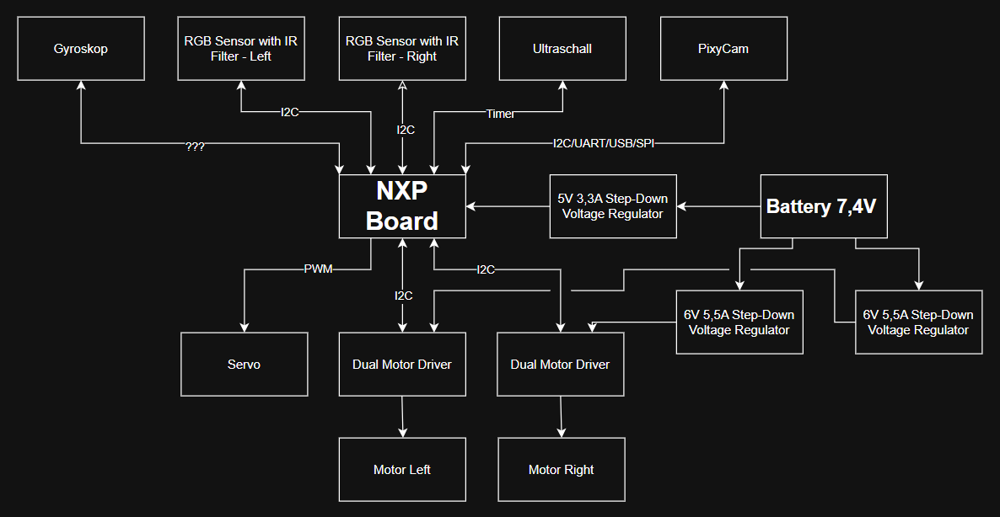

# NXPCar

Link to the NXPCup Github: 	https://github.com/NXP-Robotics/GitBook-NXPCup
Link to our car kit: 			[github.com/NXP-Robotics/GitBook-NXPCup/tree/master/2025-fall-2026-nxp-cup-mcxn947](https://github.com/NXP-Robotics/GitBook-NXPCup/tree/master/2025-fall-2026-nxp-cup-mcxn947)
NXP Race link homepage:    	https://nxpcup.nxp.com/Races

## Git and Github

Creating git localy

```
git init 
git add README.md 
git commit -m "Initial Commit" 
git branch -M main
```

Adding github

```
git remote add origin https://github.com/DanielPfister2004/NXPCar.git
git push -u origin main
```

Adding, pulling and pushing your code to GitHub

```
git add .
git commit -m "Your commit message"
git pull            
git push
```

> Always run __git pull before pushing__ your changes to prevent merge conflicts.

## Simple schematic of the Car



Made with draw.io
